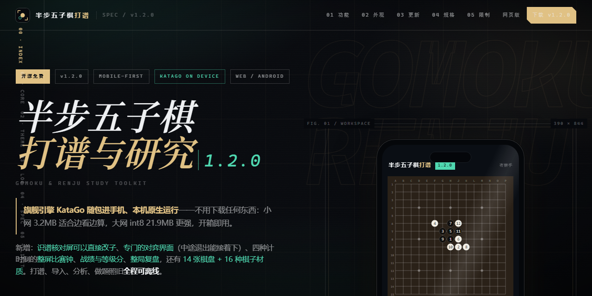
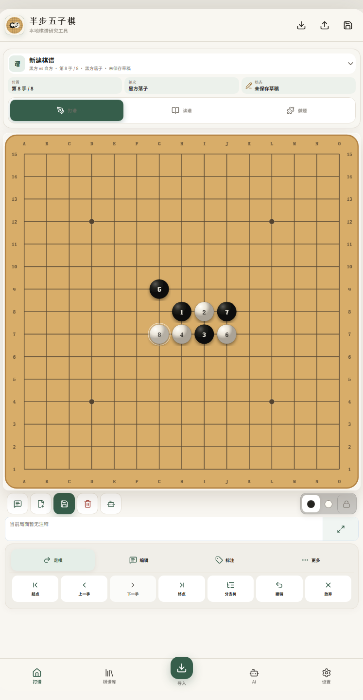
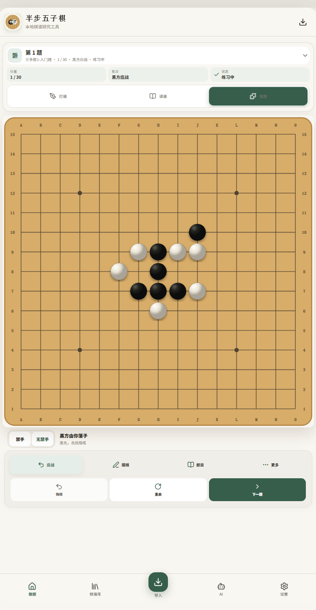
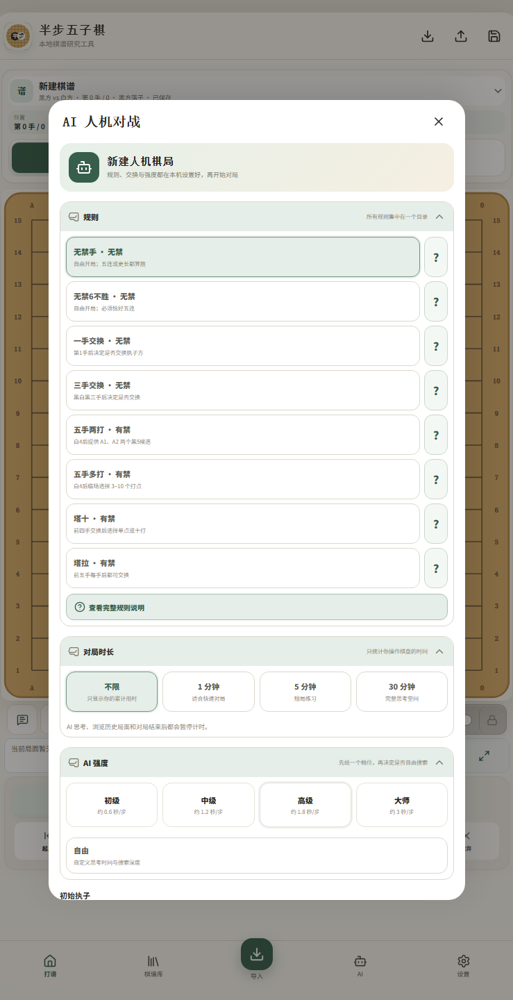
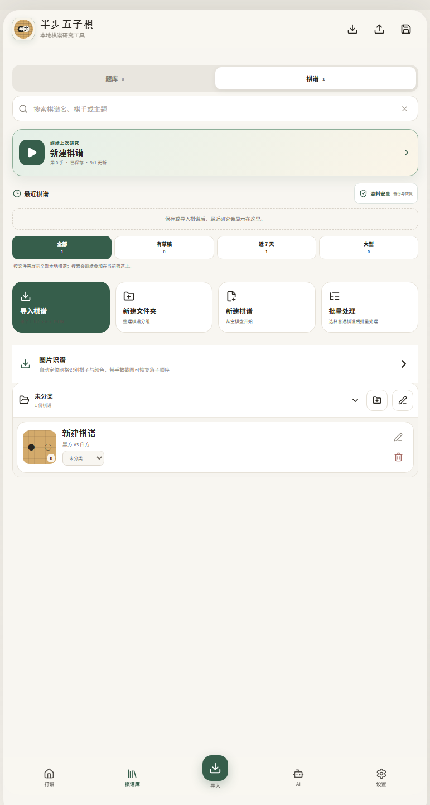

# 半步五子棋打谱

**中文** · [English](./README.en.md)



移动优先的五子棋 / 连珠打谱、读谱、做题与题库工具：共享核心用 React + TypeScript，网页版是 PWA（离线可用、含 iOS），Android 应用用 Capacitor 打包；本地 AI 引擎（Rapfi / KataGo）全部在设备上跑，不连服务器也能分析。

[](./LICENSE)
[](https://github.com/gugujiao953-ship-it/banbu-gomoku/releases/latest)
[](https://github.com/gugujiao953-ship-it/banbu-gomoku/actions/workflows/quality.yml)
[](#下载与在线使用)

当前稳定版：**v1.2.0**（2026-10-15）· 版本号、体积与 SHA-256 以 [Releases](https://github.com/gugujiao953-ship-it/banbu-gomoku/releases/latest) 为准。

## 应用一览

| **打谱** | **做题** |
|:---:|:---:|
|  |  |
| **人机对弈** | **棋谱库** |
|  |  |

## 下载与在线使用

| 方式 | 入口 | 说明 |
| --- | --- | --- |
| **网页版（含 iOS）** | **[打开网页版](https://gugujiao953-ship-it.github.io/banbu-gomoku/app/)** | 手机 / 桌面浏览器直接用，可加到主屏当离线应用 |
| Android APK | **[最新版本 Releases](https://github.com/gugujiao953-ship-it/banbu-gomoku/releases/latest)** | 每个版本都带 `.sha256` 校验文件；v1.2.0 = 90.4MB |
| 蓝奏云 | [下载链接](https://wwbwc.lanzouq.com/ihYTE4c6aube) | 密码 `hrbj` |
| 项目主页 | [gugujiao953-ship-it.github.io/banbu-gomoku](https://gugujiao953-ship-it.github.io/banbu-gomoku/) | 功能说明、更新亮点与宣传页 |

更新说明：应用内「设置 → 关于 → 本版本更新内容」随时可看；开发日志与逐版细节见 [RELEASE_NOTES.md](./RELEASE_NOTES.md)。

## 功能特性

### 打谱与棋谱库

- 5–25 路方形棋盘（默认 15 路），手机触控落子，点击已有棋子跳转到对应手数
- 棋盘四边固定显示 A–O / 15–1 坐标，支持显示/隐藏、旋转 90° 和左右镜像
- 完整变化树：创建分支、设为主线、删除当前变化及其后续；变化面板显示分支后续坐标预览，并提供「回到分叉支点创建变化」
- 改着模式：选中当前手后点棋盘空位替换坐标，保留后续变化
- 候选点模式：A–E 局面标签，节点级保存并以 SGF `LB` 交换
- 起点、上一手、下一手、终点导航，支持外接键盘左右方向键
- 当前棋谱内查找坐标、手数、节点注释、局面文字与着法评价，结果可直接跳转
- 节点注释、局面文字，以及好手 / 坏手 / 疑问手 / 趣着 / 胜着 / 唯一手 / 研究点评价
- 独立棋盘标注：1–9、胜 / 败 / 平 / 平衡、攻守提示、A–E、自定义文字，以及长按圆圈 / 三角 / 叉号
- 连珠黑方常见长连、四四、三三禁手辅助提示（研究模式不阻止落子）
- 行棋、研究、记录、应战、选题和视图收进可折叠上下文工具坞
- 本地棋谱库按棋谱名、棋手、赛事主题即时检索；约 0.5 秒防抖自动保存；普通与大型棋谱均处理内容重复和 ID 冲突，并隔离单文件失败
- LIB 不设软件层文件大小上限：使用网页 ReadLib/RenLib WASM 核心在独立 Worker 中打开，按当前局面实时查询分支与原生注释，不再把整谱转换为前端对象树
- 规则、棋手、赛事、日期等棋谱信息编辑

### 做题与训练

- 单棋盘工作区：打谱 / 做题是同一棋盘的行为状态，翻面时完整保留原棋谱会话
- 当前棋谱 / 题目栏可点击切换；题集、题号、搜索、先手与完成状态集中在同一选择器
- 做题初始盘面与尝试历史分离；悔棋回退一人一机，重启只恢复本题初始局面
- 玩家落子后由独立 Web Worker 陪练应对，支持强制停止且旧任务不能回写新题面
- 棋盘页上一题 / 下一题、题集文件夹、完成进度和导入题集持久化
- 兼容开宝二维 JSON 题库：星级、空占位、A–O / 1–15 坐标和黑白尾码
- 本地构建内置 17 个题库，共约 6,367 道题；另含「祁观vs弈心 人机大战五局」五盘棋谱和「九天指南v5-1」局面数据库入口

### AI 与对弈

- AI 思考：本地 Rapfi 分析推荐落点、胜率、主变化与 Top-3 候选；Rapfi 不可用时回退自研搜索并明确标注，不伪造胜率
- 局面分析：VCF 强制胜搜索（连续冲四，带独立证明校验），以及按成五、活四、冲四、活三和防守点给出的可解释候选排序（启发式，不是完整 VCT 证明器）
- 本地人机对战：连珠 / 标准规则、禁手辅助提示、执黑执白与开局规则选择，全部本机运行
- 开局规则：自由开局、一手交换、三手交换、五手两打、五手多打（3–10 打）、山口、索索夫-8、塔十（塔拉山口-10）与塔拉（五次交换）；另有无禁手与无禁六不胜模式

### 外观与体验

- 暗色 / 浅色主题：跟随系统或手动切换，夜间打谱友好
- 多套外观主题、棋盘与棋子预设，支持雨幕、水墨、雪落、青花瓷、像素和赛博等风格
- 程序化落子音效、音量/静音设置、落子与胜负动效，以及 `prefers-reduced-motion` 降级
- 设置页按「使用手册与反馈、核心偏好、数据与兼容、可选增强、设备布局」折叠整理，版本信息固定在底部
- 可安装 PWA、离线缓存、安卓安全区和竖屏适配

### 工具与数据

- 一键备份与恢复：棋谱库、题库、进度、草稿、设置与大型索引清单整包导出导入，恢复前完整校验
- 分享图片：棋盘局面导出为图片，可选显示手数与坐标，便于发帖与群聊分享
- 图片识谱：自动定位网格并识别棋子颜色与手数，截图带手数时可恢复落子顺序（识别后请人工校对）

## 文件兼容

已支持导入：

- `.sgf` / `.fgf`：SGF FF[4] 游戏树、UTF-8/UTF-16、设置局面（AB/AW/AE/PL）、过手、多顶层棋谱集合、注释、节点名、常用标记、着法评价和基础元数据；支持 5–25 路方形棋盘，范围外的 `SZ` 会明确拒绝，不会缩放后生成错误棋谱
- `.pos` / `.txt`：`h8i8h9`、`H8 I8 H9` 形式的坐标序列
- `.ren` / `.renjs` / `.wzq`：内容为 SGF 语法时可直接读取
- `.renju` / `.json`：本软件完整跨端数据格式；也兼容顶层含 `moves` 的明确落子列表对象，数字坐标必须声明 `coordinateBase`
- `.db` / `.dp`：支持当前识别到的 LZ4 压缩 DP/DB 棋谱数据库；会提取 15 路坐标记录、合并为变化树，并保留可识别的节点文字。不同软件的私有变体若结构不同会明确报错，不会静默导入错误棋谱。

已支持导出：

- `.sgf`：用于与 RenLib、其他棋谱工具交换
- `.renju`：完整保存变化树、注释、标记和元数据，供未来三端互通

`.lib` 是 RenLib 的二进制变化树格式。当前生产入口直接使用网页 ReadLib/RenLib 的原生 JavaScript + WASM 核心：打开后只投影当前路径和当前分支到现有 UI，分支文字与节点注释由原核心按局面查询。软件不再设置 200MB 上限；实际可打开大小取决于浏览器/WebView 可用内存。当前一次打开一份 LIB，浏览会话为只读；编辑、持久化与导出适配将在动态核心之上继续实现。

`.txt` 不是统一的五子棋专有格式，本项目只把它作为 `H8 I8 H9` 一类纯文本坐标序列的兼容入口。JSON 分为棋谱库使用的 RENJU 完整变化树、带明确 `moves` 字段的落子列表对象与题库页使用的开宝兼容题集数组，三者会分别校验，不猜测坐标基准不明的任意数组。

## 本地开发

```powershell
npm install
npm run dev          # 开发服务器
npm test             # 全量单测
npm run build        # 生产构建（AI 资产准备 → 类型检查 → 构建 → 体积检查）
```

Android（`android/` 是 Capacitor 原生工程，需要 JDK 21 与 Android SDK；发布脚本优先使用项目内工具链，不依赖全局 `JAVA_HOME`）：

```powershell
npm run android:sync
npm run android:open

cd android
.\gradlew.bat assembleDebug     # debug APK
npm run android:release         # 签名 release APK（自动构建 Web、同步 Capacitor、校验元数据）
```

发布流程说明见 [docs/Android发布流程.md](./docs/Android发布流程.md)；引擎与模型资产由构建脚本铺进包内，克隆后即可构建。

视觉回归门禁（Playwright 在 360×800 和 412×915 触控视口下实际落子，验证坐标、改着、变化、候选点、局面评价、查找、批量导入、重复去重、页面宽度与棋谱库，生成 `artifacts/` 截图）：

```powershell
node .\qa\mobile-visual.mjs
```

## 仓库结构

```
src/         应用源码（React + TypeScript）
public/      网页版静态资源（含识谱模型与 ORT 运行时）
android/     Capacitor 原生工程（原生引擎插件、随包权重）
scripts/     构建、打包与发布工具
qa/          浏览器回归门禁（见 qa/README.md）
docs/        中文文档（竞品拆解等调研笔记在 docs/reference/）
models/      AI 模型与变体索引（见 models/README.md）
marketing/   落地页源、应用截图与当前版本宣传素材
```

## 文档

| 文档 | 内容 |
| --- | --- |
| [RELEASE_NOTES.md](./RELEASE_NOTES.md) | 逐版本开发日志与实测细节 |
| [docs/项目全景说明.md](./docs/项目全景说明.md) | 项目全景与资产地图 |
| [docs/Android发布流程.md](./docs/Android发布流程.md) | 打包与发布 SOP |
| [docs/adr/](./docs/adr) | 关键技术决策记录 |
| [docs/reference/](./docs/reference) | 桌面参考软件与开宝题库的拆解笔记 |
| [docs/iOS-网页版说明.md](./docs/iOS-网页版说明.md) | iOS 上使用网页版（PWA）的说明 |

## 反馈与参与

- **有问题、想加功能**：直接[提一个 issue](https://github.com/gugujiao953-ship-it/banbu-gomoku/issues/new/choose)——仓库里带了反馈模板；把「设置 → 关于 → 兼容性自检」的输出一起贴上，定位会快很多。
- **随便聊聊**：欢迎到 [Discussions](https://github.com/gugujiao953-ship-it/banbu-gomoku/discussions) 发帖。

> 这是一个 Vibecoding 的产物，也是一款永久免费、开放源代码的软件。希望它能让手机打谱和做题更方便；如果你也做五子棋工具，欢迎互相借鉴。

## 简单致谢

- 打谱功能参考爱五子棋打谱软件与 RenLib / SGF 生态。
- 做题交互和题集格式参考开宝五子棋。
- AI 搜索思路参考 SlowRenju 等公开项目。

感谢这些前辈软件、开发者和开源社区。本项目代码以 MIT License 开放；第三方名称与内容的原始权利归各自权利人所有（见 [THIRD-PARTY-NOTICES.md](./THIRD-PARTY-NOTICES.md)）。
